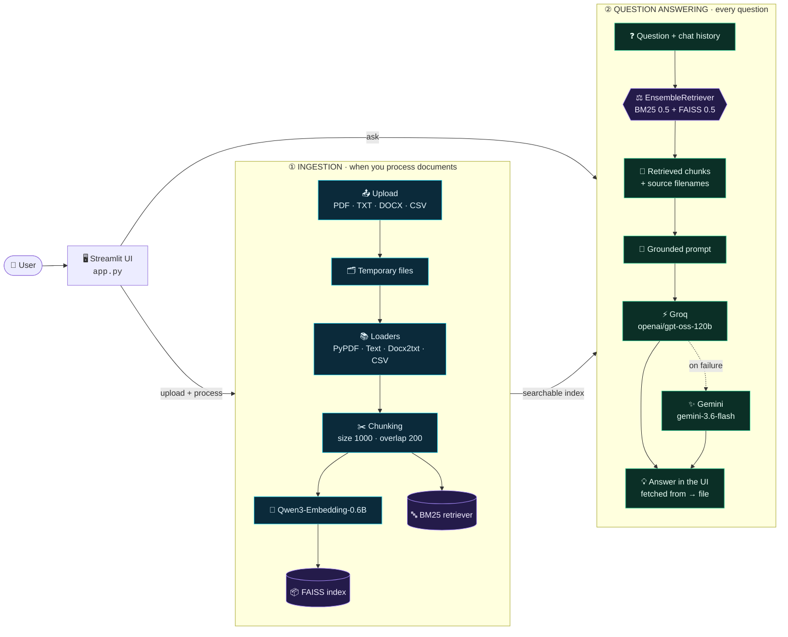
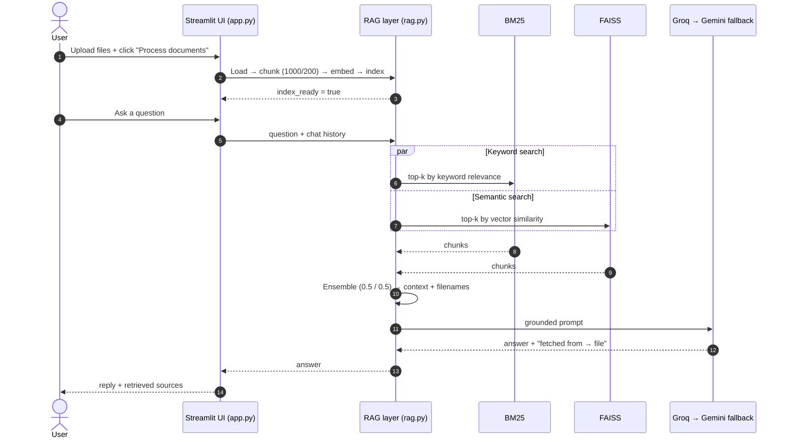

<div align="center">


<br/>

**Upload your documents. Ask in plain English. Get answers grounded in your own files.**

<br/>

[](https://www.python.org/)
[](https://streamlit.io/)
[](https://www.langchain.com/)
[](https://github.com/facebookresearch/faiss)
[](https://groq.com/)
[](https://ai.google.dev/)
[](https://huggingface.co/Qwen/Qwen3-Embedding-0.6B)

[](https://github.com/shubhumre777/nexus-rag/stargazers)
[](https://github.com/shubhumre777/nexus-rag/network/members)
[](https://github.com/shubhumre777/nexus-rag/issues)
[](https://github.com/shubhumre777/nexus-rag/commits/main)

<br/>

[**Demo**](#-demo) &nbsp;•&nbsp; [**Features**](#-features) &nbsp;•&nbsp; [**How it works**](#-how-it-works) &nbsp;•&nbsp; [**Hybrid retrieval**](#-hybrid-retrieval) &nbsp;•&nbsp; [**Quick start**](#-quick-start) &nbsp;•&nbsp; [**Deploy**](#-deploy-on-streamlit-community-cloud) &nbsp;•&nbsp; [**Limitations**](#-honest-limitations) &nbsp;•&nbsp; [**Roadmap**](#-roadmap)

</div>

<!--
  LIVE DEMO LINK: add a badge here ONLY after you have opened the deployed app and tested it end to end.
  [](https://YOUR-VERIFIED-APP-URL.streamlit.app)
-->

## 🎬 Product walkthrough

NEXUS RAG follows a simple four-step workflow:

1. **Upload and process** — add PDF, TXT, DOCX or CSV files from the sidebar and start indexing.
2. **Knowledge base ready** — the app confirms that uploaded files have been processed for the current session.
3. **Ask questions** — ask in natural language and receive answers based on retrieved passages.
4. **Check the evidence** — review retrieved source information and verify the answer against the original document. When information is missing, the assistant is instructed to say so rather than invent an answer.

> **Demo corpus note:** The example walkthrough uses eight campus-policy text files covering academic, attendance, examination, hostel, library, placement, scholarship and student-services topics.

## ✨ Features

<table>
<tr>
<td width="33%" valign="top">

### 📄 Multi-format ingestion
Upload **PDF, TXT, DOCX and CSV** files - up to **10 files** per session with a **20 MB** upload limit configured in the app.

</td>
<td width="33%" valign="top">

### 🧬 Semantic embeddings
Chunks are embedded with **Qwen3-Embedding-0.6B** and indexed in **FAISS** for similarity search by *meaning*.

</td>
<td width="33%" valign="top">

### 🔎 Hybrid retrieval
**BM25** keyword search and **FAISS** vector search are fused with LangChain's **EnsembleRetriever** (0.5 / 0.5).

</td>
</tr>
<tr>
<td width="33%" valign="top">

### 🤖 Dual-LLM generation
**Groq** (`openai/gpt-oss-120b`) answers first; **Gemini** (`gemini-3.6-flash`) is configured as the fallback through LangChain's `with_fallbacks`.

</td>
<td width="33%" valign="top">

### 🛡️ Document-grounded prompt
The prompt tells the model to answer **only from the retrieved context** and to say so when the documents don't contain the answer.

</td>
<td width="33%" valign="top">

### 💬 Chat with history
A Streamlit chat UI keeps the conversation for the active session so you can ask **follow-up questions**.

</td>
</tr>
<tr>
<td width="33%" valign="top">

### 🧾 Source filenames
Answers end with a `fetched from → filename.ext` line and the UI shows the retrieved source file.

</td>
<td width="33%" valign="top">

### 🧹 Session-scoped indexes
Each session builds its own **UUID-named** index; uploads go through temporary storage that is cleaned up after processing.

</td>
<td width="33%" valign="top">

### 🎨 Custom UI
Wide layout, custom CSS theme, project logo and a clear *upload → process → ask* flow.

</td>
</tr>
</table>

## 🧠 How it works

NEXUS RAG runs two phases: a one-time **ingestion** phase when you process documents, and a **question-answering** phase for every question you ask.

<br/>

<details open>
<summary><b>🗺️ Interactive architecture diagram (Mermaid)</b></summary>



> This diagram shows the **code flow**, not a network deployment - everything runs inside one Streamlit process.

</details>

<details>
<summary><b>🔁 Request lifecycle (sequence diagram)</b></summary>



</details>

## ⚖️ Hybrid retrieval

Keyword search is great at exact terms; vector search is great at *different wording for the same idea*. NEXUS RAG runs both and fuses them.

<br/>

| | 🔤 **BM25** | 🧭 **FAISS** (Qwen3 vectors) |
|---|---|---|
| **Finds** | Passages containing the query's important *words* | Passages with a similar *meaning* |
| **Best for** | Names, IDs, policy terms, exact phrases | Paraphrases and alternative wording |
| **Example** | "minimum attendance requirement" → chunk that literally says *minimum attendance* | "How many classes must a student attend?" → chunk about the *minimum attendance percentage* |
| **Weight** | `0.5` | `0.5` |

> [!TIP]
> The 0.5 / 0.5 weights and the 1000 / 200 chunking are a balanced **starting point**, not a proven optimum. Use `evaluation.py` and `test_dataset.csv` to tune them against your own questions.

## 🧰 Tech stack

| Layer | Technology | Role |
|---|---|---|
| **Language** | Python 3.11 | Application and RAG logic |
| **UI** | Streamlit + custom CSS | Upload workflow, chat interface, session state |
| **Orchestration** | LangChain (`core`, `community`, `classic`, `text-splitters`) | Loaders, splitting, retrievers, prompts, model wiring |
| **Embeddings** | `Qwen/Qwen3-Embedding-0.6B` via `sentence-transformers` / `langchain-huggingface` | Turns chunks and questions into vectors |
| **Vector index** | FAISS (`faiss-cpu`) | Similarity search over chunk embeddings |
| **Keyword search** | `BM25Retriever` (`rank_bm25`) | Keyword relevance retrieval |
| **Fusion** | `EnsembleRetriever` | Weighted combination of BM25 + FAISS |
| **Primary LLM** | Groq - `openai/gpt-oss-120b` (`langchain-groq`) | Writes the grounded answer |
| **Fallback LLM** | Google Gemini - `gemini-3.6-flash` (`langchain-google-genai`) | Used if the primary call fails |
| **Document parsing** | `pypdf`, `docx2txt`, `TextLoader`, `CSVLoader` | PDF / DOCX / TXT / CSV text extraction |
| **Config** | `python-dotenv`, Streamlit secrets | API keys |

> [!NOTE]
> Model identifiers and provider availability change over time. If initialisation fails, check the currently supported model IDs with Groq and Google.

## 🚀 Quick start

> [!IMPORTANT]
> You need **both** a [Groq API key](https://console.groq.com/keys) and a [Google AI Studio API key](https://aistudio.google.com/apikey). The current `RAG` class checks for both at start-up, even though Gemini is only the fallback.

```bash
# 1 · Clone
git clone https://github.com/shubhumre777/nexus-rag.git
cd nexus-rag

# 2 · Create a virtual environment (Python 3.11)
python -m venv .venv
source .venv/bin/activate        # Windows: .venv\Scripts\activate

# 3 · Install dependencies
pip install -r requirements.txt
```

**4 · Add your keys** - either as environment variables…

```bash
export GROQ_API_KEY="your-groq-key"
export GOOGLE_API_KEY="your-google-key"
```

…or in a local `.streamlit/secrets.toml` (already in `.gitignore`):

```toml
GROQ_API_KEY   = "your-groq-key"
GOOGLE_API_KEY = "your-google-key"
```

```bash
# 5 · Run
streamlit run app.py
```

Then open the URL Streamlit prints (usually `http://localhost:8501`), upload some documents, click **Process documents**, and start asking.

<details>
<summary><b>🪟 Windows (PowerShell) variant</b></summary>

```powershell
git clone https://github.com/shubhumre777/nexus-rag.git
cd nexus-rag
py -3.11 -m venv .venv
.venv\Scripts\Activate.ps1
pip install -r requirements.txt
$env:GROQ_API_KEY="your-groq-key"
$env:GOOGLE_API_KEY="your-google-key"
streamlit run app.py
```

</details>

> [!WARNING]
> Never commit real API keys. `.env` and `.streamlit/secrets.toml` are git-ignored, but `.gitignore` cannot remove a secret that was already committed - if one leaks, **revoke and rotate it** with the provider.

## ☁️ Deploy on Streamlit Community Cloud

1. Push the latest code to the `main` branch of your repository.
2. In [Streamlit Community Cloud](https://share.streamlit.io/), create a new app.
3. Select repository `shubhumre777/nexus-rag`, branch `main`, main file `app.py`.
4. Open **Advanced settings → Secrets** and paste (TOML format):

   ```toml
   GROQ_API_KEY   = "paste-your-real-groq-key-here"
   GOOGLE_API_KEY = "paste-your-real-google-key-here"
   ```

5. Deploy, read the logs, and fix any dependency / import / model / secret errors.
6. **Test the whole flow** - upload → process → ask → check sources - before sharing the link.

> [!NOTE]
> Community Cloud filesystems are ephemeral: indexes and uploads can disappear after a restart or rebuild. That's fine for a demo, but not for persistent storage.

## ⚙️ Configuration at a glance

| Setting | Value | Where it matters |
|---|---|---|
| Supported files | `.pdf` `.txt` `.docx` `.csv` | Upload widget |
| Max files / size | 10 files / 20 MB | Upload limits in `app.py` (host limits may also apply) |
| Chunk size | `1000` | Text splitting |
| Chunk overlap | `200` | Keeps context across chunk boundaries |
| Embedding model | `Qwen/Qwen3-Embedding-0.6B` | Vector retrieval |
| Retriever weights | BM25 `0.5` · FAISS `0.5` | `EnsembleRetriever` |
| Primary LLM | Groq `openai/gpt-oss-120b` | Answer generation |
| Fallback LLM | Gemini `gemini-3.6-flash` | Used if the primary call fails |
| Index location | UUID-based per-session path | Keeps concurrent sessions' indexes apart |

## 📁 Project structure

```text
nexus-rag/
├── 📄 app.py              # Streamlit app: UI, upload flow, session state, chat
├── 🧠 rag.py              # Core RAG: load → chunk → embed → index → hybrid retrieve → LLM
├── 📦 requirements.txt    # Python dependencies
├── 🧪 evaluation.py       # Evaluation script (separate from live request handling)
├── 🧪 test.py             # Test / experimentation script
├── 📊 test_dataset.csv    # Dataset used with evaluation / testing
├── ▶️  main.py             # Additional entry / script file - confirm its role before relying on it
├── 🙈 .gitignore          # Excludes venvs, .env, Streamlit secrets, FAISS + user indexes, caches
└── 🖼️  assets/
    └── logo.png           # Logo used by the interface
```

## 🔒 Security &amp; privacy

- 🔑 API keys are supplied through **Streamlit secrets** or environment variables - never in source code.
- 🧹 Uploaded files are written to **temporary storage** and cleaned up after processing; the previous index directory is removed when a new one is built.
- 🆔 Each session gets a **UUID-based index path**.
- ☁️ Retrieved passages and your question are **sent to external model providers** (Groq, and Google if the fallback is used). Don't upload confidential or regulated documents unless that is acceptable to you.

> [!CAUTION]
> The code loads FAISS indexes with `allow_dangerous_deserialization=True`. Only load indexes **created by this app** - never a FAISS file from an unknown source.

## 🧭 Honest limitations

NEXUS RAG is a **portfolio / demo project**, not a hardened multi-tenant platform. Being upfront about that:

<details>
<summary><b>Click to expand the full list</b></summary>

- **No authentication or tenant isolation** - UUID index paths separate sessions, but that is not production-grade access control.
- **In-memory chat history** - lost on restart or new session; there is no database.
- **Ephemeral hosting storage** - Community Cloud files and indexes should not be assumed durable.
- **Retrieval quality isn't guaranteed** - 0.5 / 0.5 weights and 1000 / 200 chunking are unvalidated defaults.
- **Source attribution is model-generated** - the `fetched from → file` line comes from the LLM and is parsed by the UI; it is *not* a structured, page-level citation.
- **Scanned PDFs** - image-only PDFs have no extractable text; OCR isn't part of the ingestion path.
- **Scale unknown** - no load tests, latency numbers, or concurrent-user capacity have been measured.
- **Provider dependency** - outages, rate limits, quotas or retired models affect availability, and both API keys are currently required.
- **Unpinned dependencies** - `requirements.txt` has no pinned versions and still contains leftovers (`langchain-ollama`, `ollama`) from earlier local-LLM experiments.
- **Prompting reduces, but can't eliminate, hallucinations.**

</details>

## 🗺️ Roadmap

> These are **planned improvements**, not features that exist today.

**🔧 Reliability &amp; deployment**
- [ ] Verified clean deployment + public URL recorded here
- [ ] Pin tested dependency versions; remove duplicate / unused packages
- [ ] Safe user-facing errors with private diagnostic logging
- [ ] Automated tests for each file type and common parsing failures

**📌 Better sources &amp; grounding**
- [ ] Return source metadata as structured data (filename, page, chunk ID, excerpt)
- [ ] Clickable citations and per-claim references
- [ ] Tests for questions whose answers are *absent* from the documents

**👥 Persistence &amp; users**
- [ ] Authentication and per-user document collections
- [ ] Database-backed conversation history
- [ ] Durable storage / managed vector database
- [ ] User-controlled document deletion and retention

**⚡ Performance &amp; retrieval**
- [ ] Cache the embedding model; run ingestion as a background job
- [ ] Reranking of retrieved passages
- [ ] Tune chunk size and BM25 / FAISS weights from evaluation results
- [ ] OCR for scanned PDFs

**🎛️ Product experience**
- [ ] Ingestion progress bar and per-file status
- [ ] Remove individual documents from the knowledge base
- [ ] Sample-document / demo mode
- [ ] Improved mobile layout and accessibility

## 🧪 Evaluation

The repo includes `evaluation.py`, `test.py` and `test_dataset.csv`. No accuracy, latency or capacity numbers are published here because none have been formally verified. Recommended dimensions to measure:

| Dimension | Question to answer |
|---|---|
| **Retrieval quality** | Does the right chunk come back, and near the top? Does hybrid beat BM25-only / FAISS-only? |
| **Answer correctness** | Is every claim supported by the retrieved context? Are names, dates and values preserved? |
| **Abstention** | When the answer isn't in the documents, does it clearly say so instead of guessing? |
| **Source quality** | Does the shown filename match the document that supplied the evidence? |
| **Performance** | How do indexing and query time change with file size, file count and concurrent users? |

## ❓ FAQ

<details>
<summary><b>Why use both BM25 and FAISS?</b></summary>
<br/>
BM25 reliably finds exact terms (names, IDs, policy phrases); FAISS finds passages that mean the same thing in different words. Fusing them with <code>EnsembleRetriever</code> gives broader coverage than relying on one method.
</details>

<details>
<summary><b>What's the difference between the embedding model and the LLM?</b></summary>
<br/>
<b>Qwen3-Embedding-0.6B</b> converts text into vectors for search - it never writes answers. <b>Groq / Gemini</b> read the retrieved context and write the reply.
</details>

<details>
<summary><b>Does it ever answer from general knowledge?</b></summary>
<br/>
The prompt instructs the model to use only the retrieved document context and to say when the information isn't there. That's an instruction, not a guarantee, so verify important answers against the shown source.
</details>

<details>
<summary><b>Why do I need two API keys?</b></summary>
<br/>
The current <code>RAG</code> class checks for both <code>GROQ_API_KEY</code> and <code>GOOGLE_API_KEY</code> on start-up. Making the fallback key optional is a possible future change.
</details>

<details>
<summary><b>Can it read scanned PDFs?</b></summary>
<br/>
Not reliably - image-only PDFs have no extractable text and OCR isn't part of the current ingestion path.
</details>

<details>
<summary><b>Is my data stored permanently?</b></summary>
<br/>
Uploads go through temporary storage and indexes live on the host's local filesystem for the session. Question text and retrieved passages are sent to the configured LLM providers.
</details>

## 🎤 Project summary

> *NEXUS RAG is a document question-answering application built with Python, Streamlit, LangChain, Qwen3 embeddings and FAISS. It combines BM25 keyword search with FAISS semantic search through an `EnsembleRetriever`, and uses Groq with a Gemini fallback to generate answers grounded in uploaded PDF, TXT, DOCX and CSV documents.*

```text
UPLOAD → LOAD & EXTRACT → CHUNK (1000/200) → QWEN3 EMBEDDINGS → FAISS INDEX
      → BM25 + FAISS HYBRID RETRIEVAL → CONTEXT → GROQ (GEMINI FALLBACK) → GROUNDED ANSWER
```

## 🤝 Contributing

Ideas, bug reports and pull requests are welcome.

1. Fork the repo and create a branch: `git checkout -b feature/amazing-idea`
2. Commit your changes: `git commit -m "Add amazing idea"`
3. Push and open a Pull Request.

Before every push run `git status` and make sure **no API keys, private documents or index folders** are staged.

## 👤 Author

**[@shubhumre777](https://github.com/shubhumre777)**

If NEXUS RAG helped or inspired you, a ⭐ on the repo means a lot!

<br/>

